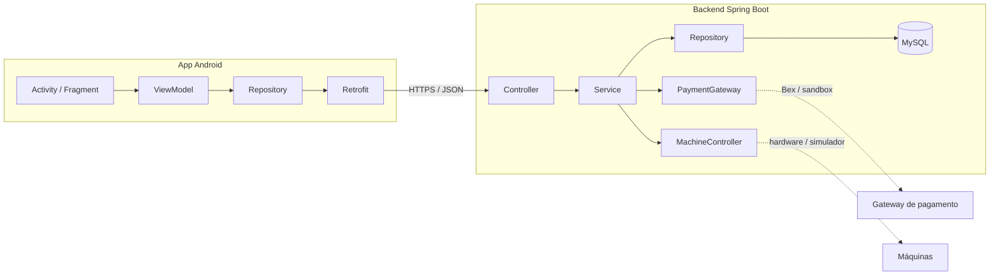
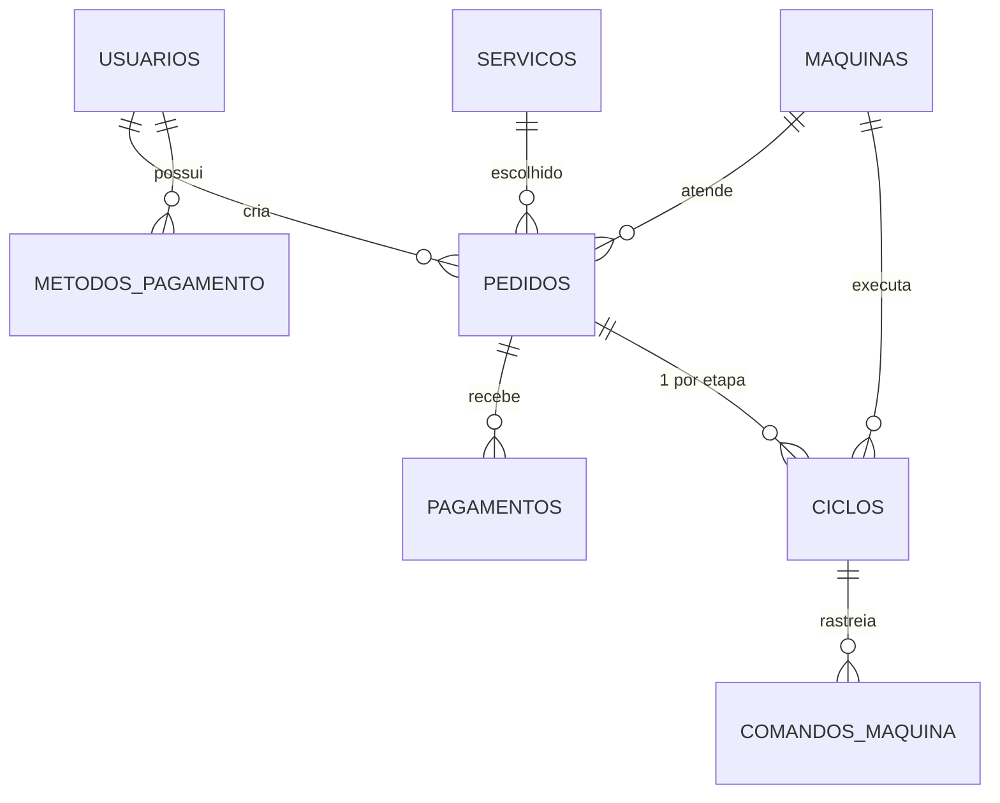
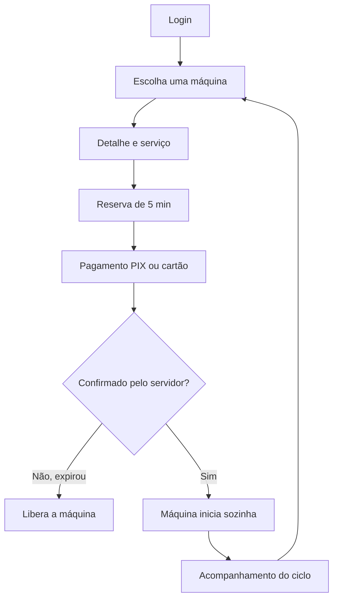
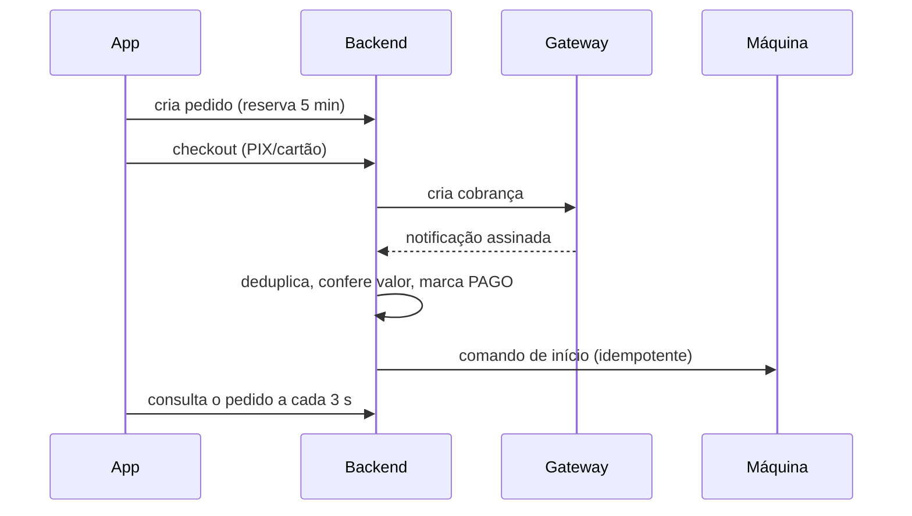

# Apresentação de desenvolvimento — lav.cametá

> **Instruções para o agente que vai montar os slides**
> - Cada seção `## Slide N` é um slide. "Conteúdo" vai no slide; "Fala" são as notas do apresentador; "Visual" sugere o que mostrar.
> - Identidade visual (ver `lav-cameta-guia-de-design.md`): roxo `#45257A` (títulos, destaques), lilás `#9B7FE0` (detalhes gráficos, nunca em texto pequeno), fundo branco ou cinza-névoa `#F4F3F7`, texto `#2E2B36`, secundário `#5E5A6B`. Fonte **Outfit** (títulos 700, texto 400). Sem gradientes. Ícones de traço (Lucide).
> - Marca escrita sempre **lav.cametá** (minúsculas). Logos em `assets/img/` (use "Logo principal" em fundo claro e "Versão negativa" em fundo roxo).
> - Diagramas estão em Mermaid: renderize ou redesenhe no estilo do slide.
> - Capturas de tela: rodar o app (ver `docs/rodar.md`) e capturar as telas citadas em cada slide.
> - Não acrescentar números, prazos ou funcionalidades que não estejam neste documento.

---

## Slide 1 — Capa
**Conteúdo**
- lav.cametá — Lavanderia de autoatendimento em Cametá (PA)
- Apresentação de desenvolvimento: dos requisitos à entrega
- Joel M. Miranda — desenvolvedor · Novembro de 2026

**Visual:** logo "Versão negativa" sobre fundo roxo `#45257A`.

---

## Slide 2 — O problema
**Conteúdo**
- Filas e incerteza: o cliente não sabe se há máquina livre.
- Pagamento e liberação da máquina dependem de atendimento manual.
- O proprietário não tem visão financeira clara do negócio.
- Público: quem não tem lavanderia ou máquina em casa e tem pouco tempo.

**Fala:** o sistema nasce para eliminar filas e automatizar a jornada do cliente, do "tem máquina livre?" até a máquina começar sozinha.

---

## Slide 3 — Objetivos (documento de requisitos, seção 1.2)
**Conteúdo**
1. Eliminar filas.
2. Mostrar a disponibilidade das máquinas em tempo real.
3. Automatizar pagamento e início do ciclo.
4. Dar ao proprietário visão financeira clara.

**Visual:** 4 cartões com ícones (relógio, máquina de lavar, cartão, gráfico).

---

## Slide 4 — Perfis e atores
| Perfil | Papel |
|---|---|
| Cliente | Usa as máquinas e paga pelos serviços |
| Administrador | Consulta relatórios e gerencia máquinas e preços |
| Gateway de pagamento | Serviço externo que confirma PIX/cartão (Bex) |
| Máquina | Equipamento que recebe o comando de início |

---

## Slide 5 — De onde vieram os requisitos
**Conteúdo**
- **Documentação do Sistema v1.0 (PDF, nov/2026):** 21 requisitos funcionais, 10 não funcionais, 13 regras de negócio, 15 casos de uso, modelo ER e dicionário de dados, 7 telas prototipadas (T01–T07), fluxo de telas, 25 casos de teste e manual do usuário.
- **Prompt do projeto:** tecnologias obrigatórias, arquitetura, organização de pastas e documentos, checkout pela API Bex.
- **Guia de design:** identidade visual oficial (logo, paleta, tipografia, componentes).

**Fala:** nada foi inventado: cada requisito foi classificado como Confirmado (está no documento), Inferido, Proposto (decisão técnica) ou Pendente (depende de informação externa).

---

## Slide 6 — Método de trabalho
**Conteúdo**
- Análise completa do PDF e do protótipo antes de codificar.
- Rastreabilidade: cada RF/RN/CT ligado a telas, endpoints, tabelas e testes.
- Regras obrigatórias para quem desenvolve (inclusive agentes de IA) em `AGENTS.md`: arquitetura, nomenclatura, segurança, "nunca simular sucesso em produção", relatório honesto do que foi testado.
- Documentação por assunto em `docs/` (requisitos, fluxos, arquitetura, banco, API, módulos, alterações).
- Mudanças pequenas e revisáveis; decisões registradas (AD-001 a AD-011).

---

## Slide 7 — Linha do tempo
| Data | Etapa | Resultado |
|---|---|---|
| 18/11/2026 | Fase 1 — Planejamento e estrutura | Análise dos requisitos, arquitetura, documentação e estrutura inicial Android/backend/banco |
| 22/11/2026 | Fases 2 a 7 — Implementação e testes | Backend, banco e app completos; testes automatizados e manuais |
| 25/11/2026 | Identidade visual | Aplicação da nova identidade roxa/lilás em todo o app |
| 26/11/2026 | Homologação em aparelho | App rodando em celular físico via Wi-Fi contra a API local |

**Visual:** linha do tempo horizontal com 4 marcos.

---

## Slide 8 — Requisitos funcionais (resumo)
| Grupo | Requisitos |
|---|---|
| Conta | RF01 cadastro · RF02 login · RF03 Google · RF04 recuperar senha · RF16 perfil |
| Máquinas | RF05 lista com status · RF06 filtros · RF07 detalhe |
| Serviço e pagamento | RF08 escolher serviço · RF09 preço antes de pagar · RF10 PIX · RF11 cartão · RF12 confirmação automática · RF13 início automático |
| Histórico | RF14 histórico · RF15 carteira |
| Administração | RF17 acesso restrito · RF18 relatório mensal · RF19 anual · RF20 resumo · RF21 última atualização |

---

## Slide 9 — Requisitos não funcionais e regras de negócio
**Não funcionais (RNF01–RNF10):** Android nativo · status em até 5 s · PIX processado em até 10 s · senhas com hash seguro · HTTPS/TLS · sem dados de cartão (tokenização) · LGPD · 99% de disponibilidade · português e identidade roxa · admin separado do cliente.

**Regras de negócio principais:**
- Preços: Lavar R$ 12, Secar R$ 10, Lavar + Secar R$ 18 (configuráveis).
- Só máquina disponível pode ser contratada; manutenção bloqueia.
- Reserva de 5 minutos durante o pagamento; sem pagamento, expira e libera.
- Máquina só inicia após pagamento confirmado; falha ao iniciar gera **estorno integral**.
- Um pedido tem exatamente um pagamento aprovado.
- Relatórios só para administrador; variação = (atual − anterior) / anterior × 100.

---

## Slide 10 — Escolha das tecnologias
| Camada | Tecnologia | Por quê |
|---|---|---|
| App | **Java nativo Android** (minSdk 31, target 35) | Exigido (RNF01 + prompt); acesso nativo a notificações e câmera, sem camada extra |
| Arquitetura do app | **MVVM** com AndroidX (ViewModel, LiveData) | Tela sem regra de negócio; estado testável |
| Comunicação | **Retrofit + OkHttp + Gson** | Padrão de mercado para REST no Android |
| Backend | **Java 21 + Spring Boot 4.1.2** | Mesma linguagem do app; ecossistema maduro para segurança, validação e transações |
| Persistência | **Spring Data JPA/Hibernate + MySQL 8.4** | Banco relacional exigido; integridade referencial e travas para concorrência |
| Migrações | **Flyway** | Banco versionado; `ddl-auto: validate` (nunca cria/altera tabelas sozinho) |
| Segurança | **Spring Security + JWT + BCrypt** | API sem estado; papéis CLIENTE/ADMIN |
| Build | **Maven Wrapper / Gradle Wrapper** | Roda sem instalar Maven/Gradle |
| Testes | **JUnit + Testcontainers (MySQL real)** | Testa concorrência e transações no banco de verdade |

**Fala:** dependências só com justificativa: QR Code gerado localmente (ZXing), checkout em Custom Tab (AndroidX Browser), login Google (Credential Manager). Os gráficos foram desenhados à mão (`ChartView`) e a injeção de dependência é manual (`AppContainer`), sem framework extra (princípio KISS).

---

## Slide 11 — Arquitetura geral

**Conteúdo**
- Monorepo com builds separados: `android/` (Gradle) e `backend/` (Maven).
- O app **nunca** acessa o banco: tudo passa pela API.
- Integrações externas isoladas por interfaces (portas e adaptadores).

---

## Slide 12 — App Android por dentro
**Conteúdo**
- `ui/` telas sem regra de negócio → `viewmodel/` estado e validação → `data/repository/` → `data/remote/` (Retrofit).
- Sessão com token JWT em armazenamento privado; sessão expirada volta ao login.
- Tempo real: atualização a cada 5 s na lista e no acompanhamento e a cada 3 s no pagamento, só com a tela visível.
- Responsivo: 1 coluna no celular, 2 no tablet; conteúdo com largura máxima de 600 dp.
- 25 telas/layouts, cerca de 4.800 linhas de Java.

---

## Slide 13 — Backend por dentro
**Conteúdo**
- Controller (valida a entrada) → Service (regras e transações) → Repository → MySQL.
- DTOs como `record`: nunca expõem hash de senha ou tokens.
- Tratamento de erros centralizado (`GlobalExceptionHandler`).
- Agendador a cada 5 s retoma pendências: reservas vencidas, pedidos pagos sem ciclo, estornos e ciclos terminados.
- 24 grupos de endpoints REST (`docs/api/contratos.md`), cerca de 4.400 linhas de Java.

---

## Slide 14 — Banco de dados

**Conteúdo**
- 10 tabelas, 3 migrações Flyway; tabelas do PDF mais 3 de controle: eventos de pagamento (deduplicação), comandos à máquina (não iniciar duas vezes) e códigos de recuperação de senha.
- Regras garantidas no próprio banco: um pagamento aprovado por pedido (índice único), um comando por chave de idempotência.
- Cartão: só token, bandeira e últimos 4 dígitos.

---

## Slide 15 — Jornada do cliente

**Visual:** capturas das telas Login, Início, Detalhe, Pagamento e Acompanhamento.

---

## Slide 16 — Pagamento seguro

**Conteúdo**
- O retorno visual do checkout **não** confirma nada: só a notificação autenticada recebida pelo backend.
- Evento repetido é processado uma única vez; valor divergente é rejeitado.
- Pagamento que chega depois da expiração é estornado automaticamente.
- Máquina que não liga após o pagamento gera **estorno integral**.

---

## Slide 17 — Concorrência: dois clientes, uma máquina
**Conteúdo**
- Reserva com trava na linha da máquina (`SELECT … FOR UPDATE`).
- Teste com 6 clientes simultâneos na mesma máquina: **só 1 reserva**.
- Defeito real encontrado pelo teste: no isolamento padrão do MySQL (`REPEATABLE READ`), a verificação lia um dado antigo e permitia reservas duplicadas. Corrigido com `READ COMMITTED` (decisão AD-008).

**Fala:** este é o melhor exemplo de por que testar no banco real: o erro não aparecia com banco em memória.

---

## Slide 18 — Segurança e LGPD
**Conteúdo**
- Senhas com BCrypt; bloqueio por 15 min após 5 tentativas erradas.
- Token JWT assinado, papéis separados: cliente não entra no admin e admin não usa rotas de cliente.
- Mensagens de login e recuperação não revelam se a conta existe.
- Nenhum segredo no código: credenciais só em variáveis de ambiente; primeiro admin criado por variável, sem senha padrão.
- App de produção só aceita HTTPS.
- Sem dados completos de cartão em banco ou log.

---

## Slide 19 — Integrações: Bex e máquinas
**Conteúdo**
- Interfaces `PaymentGateway` e `MachineController` isolam o sistema dos fornecedores.
- **Produção (padrão):** Bex e hardware. Sem contrato oficial, **falham de forma explícita** (pagamento indisponível / estorno), nunca simulam sucesso.
- **Homologação:** gateway *sandbox* (aprova/recusa cobranças de teste) e *simulador* de máquinas, ligados só por configuração. O próprio PDF prevê "gateway em sandbox e máquina simulada" no ambiente de testes.
- Quando chegar a documentação da Bex e o protocolo das máquinas, basta implementar os adaptadores; o resto do sistema não muda.

---

## Slide 20 — Área administrativa
**Conteúdo**
- Acesso restrito separado ("Acesso administrativo").
- Relatórios Mês/Ano: ganhos, variação % (com "sem base comparável" quando o período anterior é zero), gráfico de linha por semana e de barras por mês, resumo e data/hora da atualização, escolha de período.
- Gestão de máquinas (cadastro, edição, manutenção/liberação) e de preços e durações.

**Visual:** capturas de Relatórios (Mês e Ano), Máquinas e Preços.

---

## Slide 21 — Identidade visual
**Conteúdo**
- Guia de design como fonte oficial: roxo `#45257A`, lilás `#9B7FE0`, cinzas e branco; fonte Outfit; ícones Lucide.
- Logos e ícone do app recortados dos arquivos oficiais, sem alterar o desenho.
- Componentes padronizados por estilos centralizados (sem cores soltas no código).
- Status com texto **e** cor: Disponível (verde), Em uso (âmbar), Manutenção (cinza).
- Indicador do ciclo em anel, inspirado na porta da máquina da logo.
- Atende ao RNF09 (português e identidade roxa).

**Visual:** logo principal + paleta em amostras + 2 capturas (Início e Acompanhamento).

---

## Slide 22 — Qualidade: testes automatizados
| Suíte | Resultado |
|---|---|
| Backend (unitários + integração com MySQL 8.4 real via Testcontainers) | **23 testes, 0 falhas** |
| Android (unitários: validação, cadastro, formatação, ciclo) | **9 testes, 0 falhas** |
| Lint Android | **0 erros** |

**Casos do PDF cobertos:** CT01–CT03, CT05–CT24 (login, bloqueio, recuperação, catálogo, filtros, preços, PIX aprovado/expirado, cartão recusado, falha da máquina, concorrência, histórico, admin, relatórios, variação de +12,5%, carteira sem dados de cartão).

---

## Slide 23 — Qualidade: validação manual
**Conteúdo**
- Fluxo completo no emulador e em celular físico via Wi-Fi: cadastro/login → máquinas → detalhe → PIX → aprovação no sandbox → máquina em uso → acompanhamento → histórico → carteira → perfil.
- Área admin: relatórios Mês/Ano, máquinas, preços.
- Responsividade conferida em celular (1080×2400) e tablet simulado (768 e 800 dp).
- Problemas encontrados e corrigidos na revisão visual: rótulos de botão quebrando no tablet, selo de status espremendo o nome da máquina.

---

## Slide 24 — O projeto cumpre o que foi proposto? (requisitos funcionais)
| Requisito | Situação |
|---|---|
| RF01, RF02, RF05–RF09, RF12, RF14–RF21 | ✅ Implementado e testado |
| RF03 Login Google | ✅ Implementado; ⚠️ depende de configurar o Client ID do Google (não testado com conta real) |
| RF04 Recuperar senha | ✅ Implementado (código por e-mail); ⚠️ depende de servidor de e-mail (SMTP) |
| RF10 PIX / RF11 Cartão | ✅ Fluxo completo com sandbox; ⏳ provedor real Bex aguarda documentação oficial |
| RF13 Início automático | ✅ Fluxo completo com simulador; ⏳ protocolo real das máquinas aguarda fabricante |

**Fala:** todos os 21 requisitos funcionais têm fluxo implementado. O que falta não é código do sistema, e sim informação de terceiros (Bex, fabricante das máquinas) e configuração de serviços (Google, e-mail).

---

## Slide 25 — Cumprimento: não funcionais, regras e estrutura
| Item | Situação |
|---|---|
| RNF01 Android · RNF02 status ≤ 5 s · RNF04 hash · RNF06 sem cartão · RNF09 pt-BR roxo · RNF10 admin separado | ✅ Atendidos |
| RNF03 PIX ≤ 10 s | ⚠️ Processamento imediato no backend e app consultando a cada 3 s; medição real depende da Bex |
| RNF05 HTTPS/TLS | ⚠️ App de produção exige HTTPS; certificado/proxy depende da infraestrutura |
| RNF07 LGPD | ⚠️ Dados mínimos e protegidos; política de retenção ainda a definir |
| RNF08 99% de disponibilidade | ⏳ Depende da infraestrutura de produção (monitoramento, backup) |
| RN01–RN13 | ✅ Todas implementadas; combo (RN08) com proposta a validar pelo negócio |
| Arquitetura e organização pedidas no prompt (MVVM, camadas, migrações únicas, docs, AGENTS/STYLE/README) | ✅ Atendidas |

---

## Slide 26 — Decisões que precisam de validação do negócio
**Conteúdo**
- **Combo Lavar + Secar:** um pagamento (R$ 18) reserva a lavadora; ao fim da lavagem o cliente toca "Iniciar secagem" e o sistema escolhe uma secadora livre (as roupas são transferidas manualmente).
- **Durações dos ciclos:** o PDF não informa; valores iniciais 40/40/80 min, editáveis pelo admin.
- **Recuperação de senha por código** (em vez de link), para não exigir domínio verificado.
- **Telas não prototipadas no PDF** (cadastro, recuperação, acompanhamento, histórico, carteira, perfil, gestão) foram desenhadas pelo guia de design.
- **Slogan:** o protótipo T01 tem "Praticidade para o seu dia a dia", mas o guia de design atual diz que a marca não tem slogan. Definir qual vale.

---

## Slide 27 — Desafios e aprendizados
**Conteúdo**
- Concorrência só aparece em banco real: Testcontainers revelou reservas duplicadas.
- Inconsistências no PDF registradas em vez de "adivinhadas" (ex.: CT16 cita a regra RN15, que não existe; CT24 cita RN13 mas trata de cartão).
- Integrar sem contrato: portas e adaptadores permitiram terminar e testar todo o fluxo sem inventar a API da Bex.
- Spring Boot 4 exigiu o starter do Flyway para autoconfiguração.
- Ambiente: o Gradle 8.13 não roda com JDK 25/26; padronizado no JDK 21.

---

## Slide 28 — Números do projeto
| Indicador | Valor |
|---|---|
| Requisitos funcionais implementados | 21 de 21 (4 dependem de fornecedor/configuração) |
| Regras de negócio implementadas | 13 de 13 |
| Casos de teste do PDF cobertos por teste automatizado | 23 de 25 |
| Testes automatizados | 32 (23 backend + 9 Android), 0 falhas |
| Arquivos Java | 154 (≈ 4.800 linhas no app, ≈ 4.400 no backend) |
| Telas/layouts Android | 25 |
| Tabelas / migrações | 10 / 3 |
| Decisões de arquitetura registradas | 11 |

---

## Slide 29 — Demonstração (roteiro)
1. Login do cliente → lista com status (Disponível, Em uso, Manutenção).
2. Detalhe da Lavadora → escolher "Lavar" (R$ 12,00) → Continuar (reserva de 5 min).
3. Gerar PIX → aprovar no checkout de homologação → app vai sozinho para o acompanhamento.
4. Mostrar o anel do ciclo e, na lista, a máquina "Em uso · N min".
5. Login admin → relatórios Mês/Ano → colocar uma máquina em manutenção → ver no app do cliente.

**Fala:** a demonstração usa o gateway sandbox e o simulador; nenhum valor é cobrado e nenhuma máquina física é acionada.

---

## Slide 30 — Próximos passos
**Conteúdo**
- Integrar a **Bex** assim que houver documentação oficial (endpoints, autenticação, webhook, estorno, tokenização).
- Integrar as **máquinas reais** (protocolo, conectividade, sinal de término).
- Configurar e-mail (SMTP), login Google e **notificação push** de fim de ciclo com o app fechado; SMS para quem cadastrou só telefone.
- Infraestrutura de produção: HTTPS, cofre de segredos, backup, monitoramento e teste de carga com 200 usuários (CT25).
- Definir política LGPD de retenção de dados e validar com o responsável as telas não prototipadas.

---

## Slide 31 — Encerramento
**Conteúdo**
- lav.cametá: da fila à máquina ligando sozinha, com pagamento seguro e visão financeira para o dono.
- Base pronta para produção assim que os contratos externos chegarem.
- Obrigado! Perguntas?

**Visual:** logo "Versão negativa" sobre fundo roxo.
