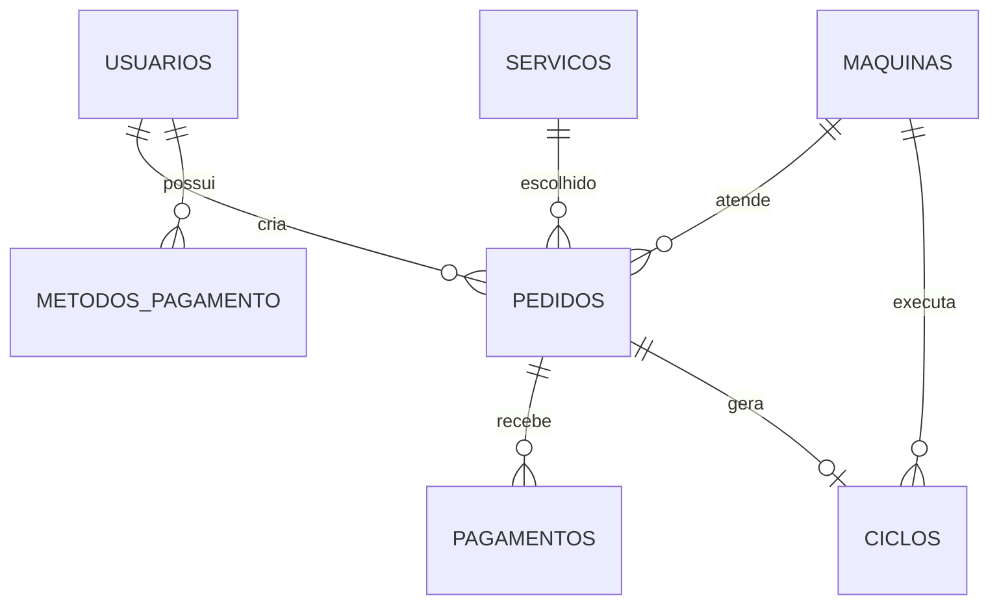

# Modelagem relacional — análise

**Origem:** PDF seções 5–7, páginas 7–11. Descrição de 8 tabelas listadas: `usuarios`, `maquinas`, `servicos`, `pedidos`, `pagamentos`, `ciclos`, `metodos_pagamento`, `relatorios_cache`. O texto da figura diz “7 tabelas principais”, divergente da lista de 8. A figura “FOTO DO BANCO DE DADOS” é um marcador no documento, não um diagrama ER acabado.

## Tabelas e chaves do PDF
- usuarios: UUID id, nome, email, telefone, senha_hash, google_id, tipo, tentativas_login, bloqueado_ate, criado_em.
- maquinas: INT id, nome, tipo, capacidade_kg, status, minutos_restantes, recursos.
- servicos: INT id, nome, descricao, preco, duracao_min.
- pedidos: UUID id, usuario_id, maquina_id, servico_id, valor_total, status, criado_em, expira_em.
- pagamentos: UUID id, pedido_id, metodo, valor, status, codigo_pix, transacao_id, pago_em.
- ciclos: UUID id, pedido_id, maquina_id, inicio_em, fim_em; campo `status` aparece na classe, mas **não** no dicionário.
- metodos_pagamento: UUID id, usuario_id, token_gateway, bandeira, ultimos4.
- relatorios_cache: referenciada no ER, sem dicionário no PDF.

## Revisão obrigatória antes da migration de domínio
1. Combo LAVAR_SECAR usa 2 equipamentos e 2 ciclos, contrariando `pedidos.maquina_id` único e cardinalidade 0..1 ciclo. Avaliar `pedido_etapas` e reservas por etapa.
2. Documento não modela reserva independente, expiração concorrente, eventos idempotentes de webhook nem comandos de hardware; planejar sem atribuir à fonte.
3. `relatorios_cache` não tem campos definidos. Tratar relatórios como consulta/agregação inicialmente.
4. Definir timezone, tratamento de dados pessoais, índices, unicidade e política de exclusão/anonimização.

Nenhuma tabela de negócio é criada nesta entrega; usar migrações apenas após validar decisões de domínio.
