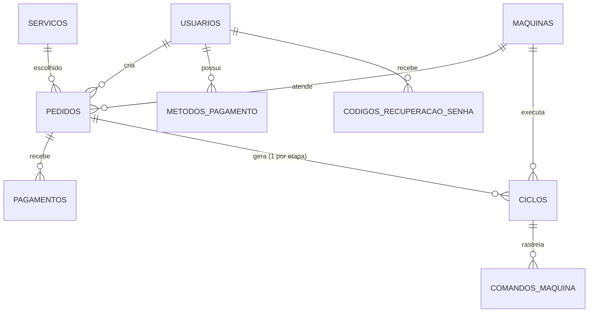

# Modelagem relacional

**Origem:** PDF seções 5–7 (dicionário de dados). Implementado nas migrations Flyway `V2__modelo_dominio.sql` e `V3__servicos_padrao.sql` (`backend/src/main/resources/db/migration`). `V1__baseline.sql` é o marcador da entrega anterior e não foi alterado.

## Tabelas
| Tabela | Conforme o PDF | Ajustes (Proposto, justificados) |
|---|---|---|
| `usuarios` | todos os campos do dicionário | `atualizado_em`; `UNIQUE` em e-mail, telefone e `google_id`; `CHECK` exige e-mail ou telefone e senha ou Google |
| `maquinas` | todos | `UNIQUE(nome)`, `CHECK capacidade > 0`, datas de controle |
| `servicos` | todos | `UNIQUE(nome)`, `CHECK preco > 0` |
| `pedidos` | todos | `atualizado_em`; índices por usuário, máquina/status e status/expiração (expiração em lote) |
| `pagamentos` | todos | `provedor`, `checkout_url`, `motivo`, `estornado_em`; status `EXPIRADO` e `ESTORNO_PENDENTE`; `UNIQUE(provedor, transacao_id)`; **RN13 garantida no banco** por coluna gerada `pedido_aprovado` + índice único |
| `ciclos` | todos | `etapa` (LAVAGEM/SECAGEM), `status`, `fim_previsto_em`; `UNIQUE(pedido_id, etapa)` |
| `metodos_pagamento` | todos (só token, bandeira e últimos 4 — RN12) | `criado_em` |
| `eventos_pagamento` | — | Idempotência de notificações: `UNIQUE(provedor, evento_id)` |
| `comandos_maquina` | — | Rastreio dos comandos; `UNIQUE(chave_idempotencia)` impede iniciar a máquina duas vezes |
| `codigos_recuperacao_senha` | — | Código de uso único (hash SHA-256), validade de 30 min, máx. 5 tentativas |

`relatorios_cache` (citada no ER, sem campos no PDF) **não** foi criada: os relatórios são agregações diretas, indexadas por `pagamentos(status, pago_em)`. Criar cache só se o volume exigir.

## Decisões
1. **Combo (RN08):** o pedido aponta para a lavadora; a secadora é registrada no ciclo da etapa `SECAGEM`. Pedido 1 — N ciclos (no máximo um por etapa), em vez do 0..1 do PDF.
2. **Reserva:** não há status `RESERVADA` persistido; a reserva é o pedido `AGUARDANDO_PAGAMENTO` com `expira_em` futuro. A criação trava a linha da máquina (`SELECT … FOR UPDATE`) e a conexão usa `READ COMMITTED`, garantindo que só o primeiro cliente reserve (CT16).
3. **Datas** em `DATETIME(6)` UTC; relatórios convertem para `America/Belem`.
4. **UUID** como `CHAR(36)` (legível e compatível com o dicionário).
5. **Dados iniciais:** apenas os serviços com preços de RN01. Durações (40/40/80 min) não constam no PDF — **Pendente** de confirmação, editáveis pelo administrador. Máquinas e administrador são cadastrados pelo operador (sem dados fictícios).

## Pendências
Política de retenção/anonimização (LGPD), backup e restauração, e eventual particionamento de `pagamentos` por data quando houver volume.
