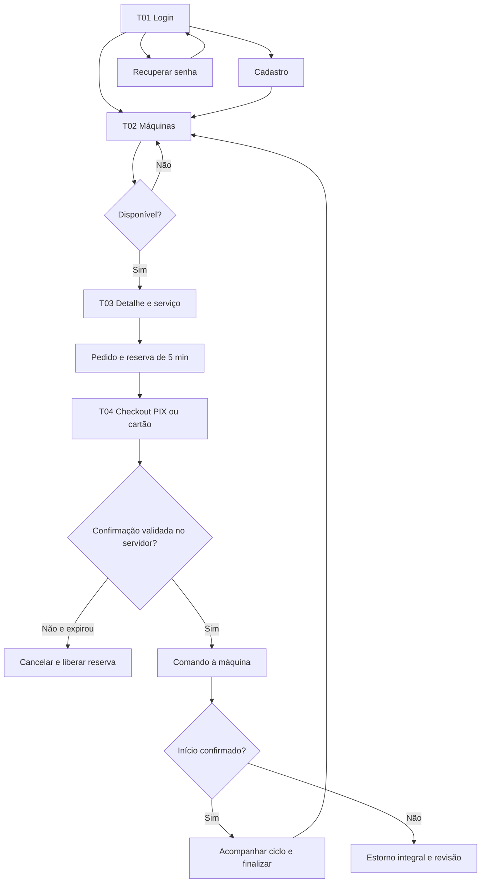
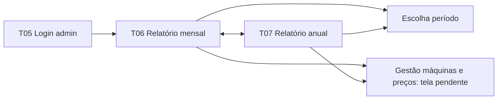

# Jornadas e fluxos

Origem: seções 3, 8 e 9 do PDF, páginas 5–6 e 11–13. T01–T07 são telas descritas; telas adicionais estão **previstas e não prototipadas**.

## Matriz fluxo → sistema
| Fluxo | Telas | Endpoints planejados, não implementados | Entidades | Regras |
|---|---|---|---|---|
| Autenticar | T01, Cadastro, Recuperação | `/auth/*` | usuarios | RN011, RN012 |
| Consultar | T02, T03 | `GET /machines`, `GET /machines/{id}` | maquinas, servicos | RN002, RN007 |
| Reservar | T03, T04 | `POST /orders` | pedidos, maquinas | RN001, RN003, RN005, RN008 |
| Pagar | T04 | `POST /orders/{id}/checkout`, webhook a definir | pagamentos, pedidos | RN004, RN013 |
| Iniciar/acompanhar | Acompanhamento | `GET /orders/{id}/cycle` | ciclos, maquinas | RN004, RN006 |
| Relatórios | T05–T07 | `GET /admin/reports` | pedidos, pagamentos | RN009–RN011 |
| Administração | Não prototipada | `GET/PUT /admin/machines` | maquinas, servicos | RN001, RN007 |

Endpoints são **propostos** e exigem revisão da autenticação, versão e integração Bex.
